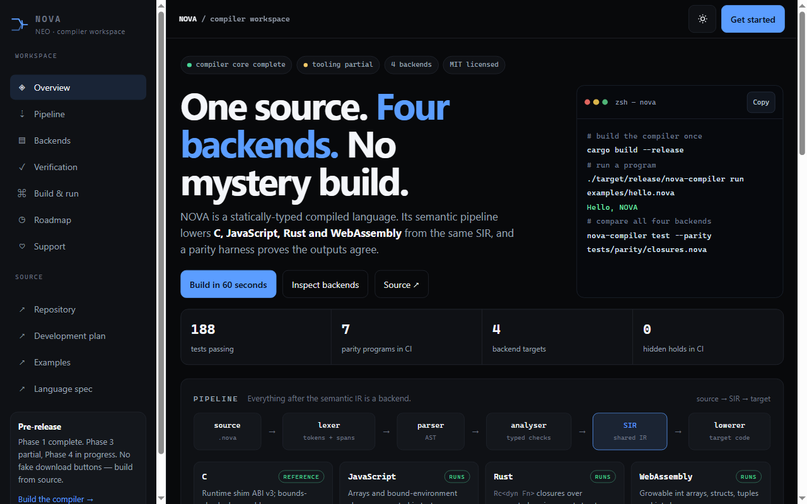
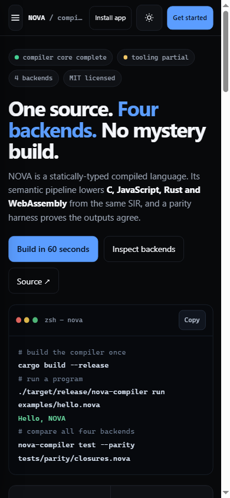
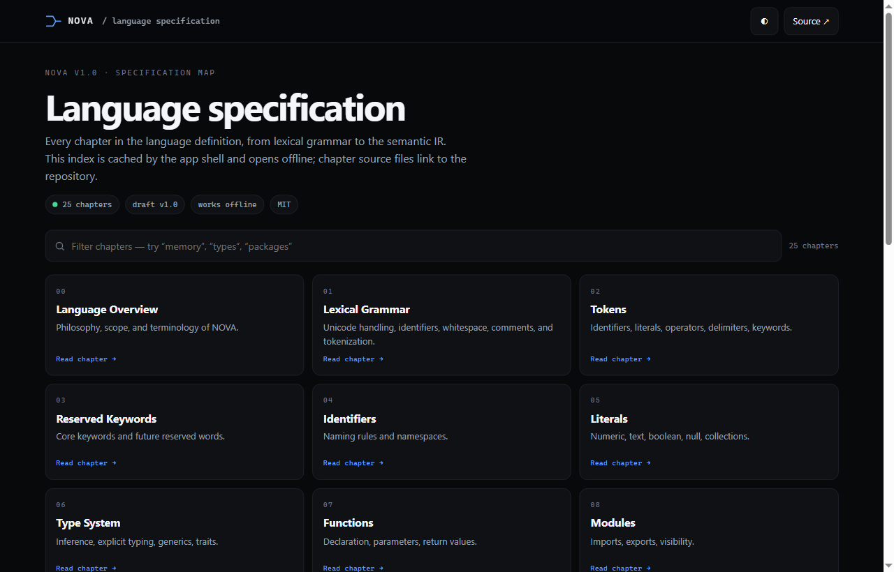

<div align="center">


# NOVA — Semantic Programming Platform

[](LICENSE)




<details>
<summary>Mobile layout</summary>



</details>

**A statically-typed, compiled systems programming language.** Its compiler lowers NOVA source through a semantic pipeline — lexer, parser, semantic analyser, SIR, lowerer — to four backends: **C, JavaScript, Rust and WebAssembly**, with a runtime shim, package manager, language server and debugger alongside.

<a href="https://drsamonline.github.io/NEO/"></a>
<a href="https://img.shields.io/badge/Phase%201-Complete-brightgreen"></a>
<a href="https://img.shields.io/badge/Phase%202-Complete-brightgreen"></a>
<a href="https://img.shields.io/badge/Phase%203-Partial-yellow"></a>
<a href="https://img.shields.io/badge/Phase%204-In%20Progress-yellow"></a>
<a href="Cargo.toml"></a>
<a href="backends/"></a>
<a href="https://img.shields.io/badge/language-Rust-dea584"></a>
<a href="docs/manifest.webmanifest"></a>
<a href="tests/parity/"></a>

**[Landing page](https://drsamonline.github.io/NEO/)** · **[Examples](examples/)** · **[Language spec](docs/language/)** · **[Development plan](DEV_PLAN.md)** · **[Architecture](ARCHITECTURE.md)** · **[All projects](https://drsamonline.github.io/)**

<sub>Live demo: [the app-like landing page](https://drsamonline.github.io/NEO/) · offline-capable (PWA) · pre-release (Phase 4 in progress).</sub>

</div>

---


## Overview

NOVA is a statically-typed, compiled systems programming language with a complete tooling ecosystem. The compiler transforms NOVA source code into multiple target languages (C, JavaScript, Rust, WebAssembly) through a robust semantic analysis pipeline.

## Current Status

**✅ Phase 1: Compiler Core - COMPLETE (C is the reference; JS, Rust and WASM run an exercised subset)**
- Full lexer, parser, semantic analyzer implemented
- SIR (Semantic Intermediate Representation) defined
- Lowerer converts AST to SIR
- Four backend crates: C, JavaScript, Rust, WebAssembly. C is the reference and
  links the runtime shim. JavaScript and Rust run the exercised subset,
  including arrays and closures (Rust closures are `Rc<dyn Fn(..) -> ..>` over
  generated environment structs). WebAssembly runs integers, booleans, string
  literals, `print`, recursion, `if`/`while`/range-`for`, growable int arrays,
  structs/tuples and `int` closures through `backends/wasm/host.mjs`; array
  access is bounds-checked and unsupported signatures are rejected instead of
  emitting placeholder code.
- `nova-compiler test --parity` compares stdout and exit status across all four
  backends. CI runs it over every `examples/*.nova` and `tests/parity/*.nova`
  program. A backend that **disagrees** and one that **could not run** are reported
  separately — `parity: FAILED (... disagree with the reference: c, js)` against
  `parity: INCOMPLETE (... held — install the toolchain to check: wasm)` — because a
  wrong answer and an unanswered question are not the same result.
- **317 `#[test]` functions across the workspace** (`cargo test --workspace`; the WASM
  execution tests need `node` and `wat2wasm`). CI runs them on every push.

**✅ Phase 2: a Rust runtime crate that was never wired in — deleted 2026-11-26**

`runtime/` was a workspace crate of 2,480 lines: `gc.rs`, `types.rs`, `ffi.rs`, `error.rs`,
`memory.rs`, `threading/`, `async_rt/`, `io/`, `lib.rs`, with thirty-three unit tests of its own, all passing.

**Nothing depended on it.** No crate listed `nova-runtime` in `[dependencies]`, and generated C
links only the `nova_runtime` shim in `compiler/src/runtime.rs`. That shim contains **no**
garbage collector, **no** arena allocator, **no** FFI layer and **no** threading.

It is **gone** (ADR 0021), because 2,480 lines whose presence makes "NOVA has a garbage collector"
a reading a person can reach from the file tree is the exact defect this repository spent the week
removing. Git history keeps every line if a future decision wants them back.

So the compiled language, as it ships:

| Claimed here previously | Actually true of a NOVA program |
|---|---|
| garbage collection, arena allocation | **none** — every allocation leaks; the process exits to reclaim |
| FFI, C interop | **none** |
| threading, async, channels | **none**, and [ADR 0020](docs/adr/0020-concurrency-model.md) records why |
| backtraces | the **debugger** has them; the language does not |

**🔄 Phase 3: Tooling - PARTIAL (crates exist, integration incomplete)**
- 🟡 Package manager (1,984 lines) — `init`/`build`/`run` real; path and git dependencies resolve; **the registry refuses** rather than inventing packages
- 🟡 Language server (1,668 lines) — LSP handlers and real compiler diagnostics; go-to-definition is a string search
- 🟡 Debugger (1,737 lines) — REPL and breakpoints real; **backtrace, `list`, `print` and DWARF refuse** rather than inventing frames

**🔄 Phase 4: Polish & Integration - IN PROGRESS**
- Standard library implementation
- LSP-compiler integration for real-time diagnostics
- Debugger-binary integration
- End-to-end testing
- Performance optimization
- Documentation

See [Development Plan](DEV_PLAN.md) for detailed status. Where this summary and
`DEV_PLAN.md` disagree, `DEV_PLAN.md` is authoritative.

## Quick Start

```bash
# Build the compiler (Rust toolchain, plus a C compiler on PATH)
cargo build --release

# Print the compiler version
./target/release/nova-compiler --version

# Check which toolchains and backends are ready (add --json for scripts)
./target/release/nova-compiler doctor

# Format a file — whitespace only; no token changes
./target/release/nova-compiler fmt examples/hello.nova

# Compile and run a program
./target/release/nova-compiler run examples/hello.nova

# Build an executable
./target/release/nova-compiler build examples/fibonacci.nova -o fibonacci
```

## Project Structure

```
/workspace
├── compiler/           # Main compiler (8,931 LOC)
│   ├── src/lexer/     # Tokenization (340 lines)
│   ├── src/parser/    # Recursive descent parser (1,506 lines)
│   ├── src/sema/      # Semantic analysis (1,302 lines)
│   ├── src/lowerer/   # AST→SIR lowering (3,190 lines)
│   └── src/backend/   # C code generation (846 lines) — the one the CLI uses
├── crates/nova-common/ # Shared AST, tokens, spans, diagnostics, SIR (1,603 lines)
├── backends/          # Generators for the other three targets (3,085 lines)
│   ├── javascript/    # JavaScript backend (478 lines)
│   ├── rust/          # Rust backend (748 lines)
│   └── wasm/          # WebAssembly backend, WAT emitter + Node host (1,859 lines)
│   ├── src/memory.rs  # Memory utilities (195 lines)
│   ├── src/types.rs   # Runtime string/array/option types (276 lines)
│   ├── src/error.rs   # Error handling (232 lines)
│   ├── src/ffi.rs     # C interop (193 lines)
│   ├── src/gc.rs      # Reference-counted GC (420 lines)
│   ├── src/lib.rs     # Core library (81 lines)
│   ├── src/io/        # File and stream I/O (534 lines)
│   ├── src/threading/ # Threading primitives (314 lines)
│   └── src/async_rt/  # Futures and delay (114 lines)
├── pkg/               # Package manager (1,780 lines)
│   └── src/           # CLI, manifest, resolver, registry
├── lsp/               # Language server (988 lines)
│   └── src/main.rs    # LSP handlers, completions, diagnostics
├── dbg/               # Debugger (1,733 lines)
│   └── src/           # REPL, breakpoints, sessions, target control
├── crates/nova-common/ # Shared utilities
├── stdlib/            # Standard library (scaffolds)
├── examples/          # Example programs
└── tests/             # Test suite
```

Line counts above are `wc -l` output, last checked on 2026-11-17. Regenerate them
with `wc -l` rather than by hand; a stale table is how this one drifted from
3,500 to 8,931.

## Features

### Implemented ✅
- **Lexical Analysis**: complete tokenization, `#`/`//` comments, escapes, `=>`
- **Parsing**: recursive descent for the full grammar, including generics, slices,
  struct literals, `match`, closures, casts and `static`
- **Semantic Analysis**: scopes, name resolution, call arity/type checking with
  expression spans, return checking, generic-call acceptance
- **Lowering to SIR**: structs, field assignment, `impl` methods, enums, `match`,
  arrays, generic instantiation
- **C code generation**: runnable programs linked against the runtime shim (ABI v3);
  statement `match` becomes a C `switch` (guarded arms use an if/else chain),
  arrays are bounds-checked and growable,
  payload-carrying enums/`Option<T>` are tagged structs, generic structs are
  monomorphised
- **Modules**: `use` and `mod` load sibling and standard-library files
- **Strings**: slicing (`text[a..b]`) and string-literal `match` arms
- **Generics**: functions, enums, structs and impl methods are monomorphised
- **Closures and tuples**: lifted closures with heap environments, typed closure
  parameters and `fn(A) -> B` values on C, JS, Rust and WASM;
  `NovaTuple_*` structs with `let (a, b) = pair;` destructuring
- **Backends**: `emit --target c|js|rust|wasm` selects a generator; JS, Rust and
  WASM output is executed in tests, `test --parity` runs all four when `node` and
  `wat2wasm` are installed, and   `tests/parity/` adds growable-array, struct/tuple, block-expression and closure
  programs to the CI corpus; build/run link C
- **Builtins**: compiler-declared `__builtin_*` functions for printing, strings,
  array length, panic and exit
- **Runtime crate**: memory utilities, runtime types, errors, FFI, reference-counted
  GC, file I/O, threading, async helpers (not yet linked to generated C)
- **Tooling**: package manager, language server and debugger crates with tests
  (partial integration; see the status section)

### Coming Soon 🚧
- WebAssembly closures with floating-point parameters or results (the emitter
  rejects those signatures; the parity harness reports `wasm held` only when
  `wat2wasm` or `node` is missing). String-returning closures work: literals are
  NUL-terminated in linear memory and printed through the host's `print_cstr`
- Multi-payload enum variants and value-position match bindings
- General (non-array) reference lowering
- Growable arrays are implemented; element types other than `int` are not
- WASM struct fields cannot hold floats yet, and an out-of-bounds WASM index
  traps while C reports a runtime error, so those programs are not
  stdout-identical
- LSP go-to-definition/references, DWARF debugger, real package registry

## Install & downloads

| Channel | Available? | How |
|---|---|---|
| Source (recommended) | ✅ | `git clone https://github.com/drsamonline/NEO.git && cd NEO && cargo build --release` |
| Static site / PWA (HTML) | ✅ | Open the [live landing page](https://drsamonline.github.io/NEO/) and install it from the browser; it caches its shell and works offline |
| Native binary (Linux/macOS) | ✅ build locally | `cargo build --release` |
| Windows executable (experimental) | ⚠️ prebuilt | [nova-compiler-0.6.1-windows-x86_64.exe](dist/nova-compiler-0.6.1-windows-x86_64.exe) · [SHA-256](dist/nova-compiler-0.6.1-windows-x86_64.exe.sha256) · cross-built, unsigned, not executed in this environment |
| APK (Android) | ❌ | No Android target or Gradle project exists; the compiler is a host tool, not an app |
| npm / crates.io package | ❌ | Not published; use the Cargo workspace |

## Project facts

| Field | Value |
|---|---|
| Description | Statically-typed compiled language with one semantic pipeline and C, JavaScript, Rust and WebAssembly backends |
| Repository | [github.com/drsamonline/NEO](https://github.com/drsamonline/NEO) |
| Live demo | [drsamonline.github.io/NEO](https://drsamonline.github.io/NEO/) |
| Author | [Dr Sohil Momin](https://drsamonline.github.io/) |
| Status | Pre-release: Phase 1 complete, Phase 3 partial, Phase 4 in progress |
| Tests | 247 passing, 0 failing, 0 ignored (`cargo test --workspace`); 7 parity programs in `tests/parity/` plus the 3 root examples, all compared across four backends by `test --parity` |
| License | MIT (see [LICENSE](LICENSE)) |
| Releases | [`v0.7.0`](https://github.com/drsamonline/NEO/releases/tag/v0.7.0) — three platform archives with SHA-256 checksums. The two earlier releases (`v0.6.0`, `v0.6.1`) are empty: both tagged on one commit with no artifacts. |

### Suggested GitHub topics

`compiler` · `programming-language` · `rust` · `webassembly` · `transpiler` · `static-typing` · `language-design` · `pwa` · `developer-tools`

## Documentation



- [Documentation index](docs/README.md) - Everything written down, in one place
- [Development Plan](DEV_PLAN.md) - Current progress and roadmap
- [Architecture](ARCHITECTURE.md) - System design
- [Language spec status](docs/language/README.md) - what is specified and what is still unwritten
- [Language Tour](website/docs/language-tour.md) - Language features
- [Getting Started](website/docs/getting-started.md) - Installation guide
- [Error codes](docs/errors.md) - every diagnostic code the compiler emits
- [FAQ](FAQ.md) - Common questions

<!-- support:sweep -->
## Support

| | |
|---|---|
| UPI (India) | `drsohilboi@ybl` — payee Dr Sohil Momin, open amount, or scan [the QR](docs/assets/upi-qr.svg) |
| GitHub Sponsors | [github.com/sponsors/drsamonline](https://github.com/sponsors/drsamonline) |
| Ko-fi | [ko-fi.com/matneo](https://ko-fi.com/matneo) |
| PayPal | [paypal.me/drsohilmomin](https://paypal.me/drsohilmomin?locale.x=en_GB&country.x=IN) |
| My books | [Amazon author store](https://www.amazon.com/stores/author/B08ZT331LY/allbooks?ccs_id=aed72b9f-71d9-41dc-adee-e9368a317acc) |
| More apps | [drsamonline.github.io](https://drsamonline.github.io/) |
| Email | [sohilmomin2000@gmail.com](mailto:sohilmomin2000@gmail.com) |

## License

See LICENSE file in repository root.

## Contributing

See [CONTRIBUTING.md](CONTRIBUTING.md) for guidelines.

---

**Last Updated**: 2026-11-18
**Current stage**: Phase 3 partial, Phase 4 in progress (see [DEV_PLAN.md](DEV_PLAN.md); it is authoritative)
**Test suite**: 247 passing, 0 failing (verified in CI)
